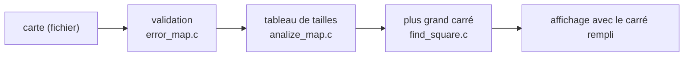

<div align="center">

# 🏊 Piscine 42

**Mon mois d'immersion à l'école 42 (septembre 2021) : du C, du shell, des projets en équipe.**


</div>

---

## 📌 La Piscine, c'est quoi ?

La Piscine est la sélection de l'école 42 : **4 semaines intensives, 7 jours sur 7**, sans cours magistraux. On apprend le C en résolvant des exercices corrigés par un programme automatique (la « Moulinette ») et par les autres candidats, sous une norme de code stricte (25 lignes par fonction, pas de `for`, fonctions de la libc interdites…).

Ce dépôt garde **mes rendus tels quels**, comme trace de ce parcours.

---

## 🗂️ Organisation des fichiers

```
Piscine-ecole-42/
├── exercices-C/          modules C00 → C07 (un dossier par exercice)
│   ├── c00/ … c03/       affichage, pointeurs, chaînes de caractères
│   ├── c04/ … c05/       conversions (atoi, bases), récursivité
│   └── c06/ … c07/       arguments du programme, allocation dynamique
├── rush/                 projets en équipe sur un week-end
│   ├── rush00/           dessiner des rectangles en ASCII
│   ├── rush01/           « Skyscrapers » : résolution d'une grille par backtracking
│   └── rush02/           convertir un nombre en toutes lettres à partir d'un dictionnaire
│       ├── final/        version rendue par l'équipe
│       └── brouillon-*/  essais individuels
├── BSQ/                  projet final : trouver le plus grand carré dans une carte
│   ├── final/
│   └── brouillon/
└── sujets/               énoncés officiels (C, shell, rush, BSQ)
```

---

## ⚙️ Les projets marquants

| Projet | Le défi | Ce que j'y ai appris |
|---|---|---|
| **C00 → C07** | réécrire soi-même `putchar`, `strlen`, `atoi`, `split`… | pointeurs, mémoire, rigueur de la norme |
| **Rush 01 — Skyscrapers** | remplir une grille 4×4 selon des contraintes de visibilité | backtracking, travail à plusieurs sur un même code |
| **Rush 02** | « 42 » → « quarante-deux », dictionnaire fourni | lecture de fichiers, découpage, gestion d'erreurs |
| **BSQ** | plus grand carré vide dans une carte de plusieurs milliers de lignes | programmation dynamique, performance |



---

## 🛠️ Compiler un exercice

```bash
cd exercices-C/c00/ex00
cc -Wall -Wextra -Werror ft_putchar.c main.c -o test   # ajouter un main de test
```

Les exercices de la Piscine sont des fonctions isolées : il faut écrire un petit `main` pour les tester.
**BSQ et les rushs sont conservés dans l'état où ils ont été rendus** — certains brouillons ne compilent pas en l'état.

---

## 💻 Environnement

| | |
|---|---|
| **Langage** | C (norme 42), Shell |
| **Système** | Linux / macOS, `cc` (clang ou gcc) |
| **Période** | septembre 2021 |

---

<div align="center"><sub>Les en-têtes des fichiers indiquent les identifiants 42 des auteurs de chaque fichier, coéquipiers compris.</sub></div>
